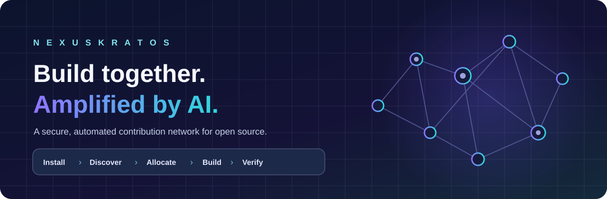

  

  **The proposed open-source marketplace for secure, automated AI-assisted contributions.**

  [Vision](docs/vision/marketplace.md) · [Architecture](docs/architecture/system.md) · [Security](docs/security/threat-model.md) · [Brainstorming](docs/brainstorming/2026-11-05-design-notes.md) · [Website](https://nexuskratos.dev)

> **Pre-alpha / design stage.** There is currently **no released daemon, marketplace, signup, control plane, or working contribution automation**. This repository holds the foundation, proposed architecture and planning. The live website is informational, not a usable product.

## Open source should be easier to contribute to

Imagine you have spare compute, an AI coding subscription or API access, and a few hours to help projects you believe in. You should not have to learn GitHub, coordinate agents, manage branches, invoke a CLI by hand or watch a terminal all day.

**Nexus Kratos aims to make contribution as simple as: install a verified daemon, sign in, choose trusted projects, set resources and safety limits, then enable automation.** The system would pick compatible tasks, run them locally within your limits, gather evidence, route work through independent review and submit protected GitHub pull requests. Your dashboard, email or Telegram would keep you informed.

**Automation does not mean automatic trust.** Projects, task instructions, output patches and model-generated claims are untrusted inputs. The donor retains the local off-switch. Maintainers retain policy and merge authority.

## The planned contributor experience

~~~mermaid
flowchart LR
  A["1. Install signed daemon"] --> B["2. Sign in and discover projects"]
  B --> C["3. Choose projects / roles"]
  C --> D["4. Set resources and trust limits"]
  D --> E["5. Contribute automatically"]
  E --> F["6. Review, PR and accepted impact"]
  F --> G["7. Track status, badges and notifications"]
  E -. "pause / revoke" .-> D
~~~

No personal GitHub account is planned for ordinary donors. GitHub stays behind the platform as the project's code and PR system; maintainers can keep using GitHub directly. The planned local web UI is the primary donor interface.

### What donors control

- **Which projects to support:** discover community-proposed, moderated open-source ideas; explicitly opt in per project.
- **How much to offer:** global and per-project concurrency, CPU, memory, disk, time windows, models/provider allowlists and measurable budget or usage limits.
- **What may run:** reviewed trust profiles, network and filesystem policy, permitted tasks, headless behavior and human-attention requirements.
- **When to stop:** pause, cancel or revoke locally even if the coordinator is unreachable.
- **What to see:** active tasks, progress, actual vs estimated vs unknown usage, scan/test receipts, review history, PRs, contribution milestones and notification preferences.

A guarantee that a provider cannot technically enforce—for example a hard dollar limit for an unmetered subscription—must never be advertised as a guarantee.

## How the architecture is intended to work

~~~mermaid
flowchart TB
  Community["Community / catalog / project proposals"] --> Control["Control plane: identity, plans, leases, policies"]
  Control <--> Donor["Contributor daemon + local web UI"]
  Donor --> Runner["Versioned runner adapters"]
  Runner --> Sandbox["Untrusted tasks in isolated workspace"]
  Sandbox --> Evidence["Artifacts + evidence"]
  Evidence --> Gate["Security scans + independent review + QA"]
  Gate --> Git["Scoped GitHub App / protected PR workflow"]
  Control -. "redacted events" .-> Warboard["Optional Warboard visibility"]
~~~

The **control plane** manages project discovery, account and device enrollment, task dependency graphs, resource-aware scheduling, expiring assignment leases, audit logs, notifications and governance. A transactional datastore and outbox are proposed for durable coordination.

The **contributor daemon** is planned as a signed Rust binary with a local web UI, device journal, trusted supervisor, model/runner adapters and a separately isolated repository executor. Tasks are headless by default; needs-attention cases are explicit and bounded. Provider credentials remain local, separated from repository execution.

The **GitHub integration** publishes attempt-specific branches and PRs using limited GitHub App permissions, but it does not permit donors or their models to merge unreviewed code. Candidate review and QA evidence must bind to the exact commit and repository base.

**Warboard** remains independently developed and optional; it may consume redacted progress and telemetry without becoming a scheduling dependency.

Read the [detailed system architecture](docs/architecture/system.md) and [architecture/workflow diagrams](docs/architecture/diagrams.md).

## Marketplace, roles and recognition

Projects can be **suggested → reviewed → approved → active → paused/archived**. A project page should explain maintainers, license, benefit, risk, task pool, contribution needs and accepted results. Listing a project is not equivalent to donor permission to execute its code.

| Role | Responsibility |
| --- | --- |
| Project proposer / community member | Suggest useful open-source projects and discuss goals |
| Architect / planner | Convert goals into versioned plans and dependency-aware tasks |
| Coordinator | Match eligible tasks to donated capacity; enforce leases and routing |
| Builder / contributor | Donate bounded AI execution, tests, review or documentation |
| Independent QA / security reviewer | Validate exact candidate, test output and security evidence |
| Maintainer / moderator | Approve projects, govern policy, review and accept changes |

Badges and reputation should recognize **verified, accepted work and helpful reviews**, never tokens spent or unsupervised compute consumption. The system must resist fraudulent contributions and badge farming.

## Security is foundational, not an afterthought

The intended defense-in-depth includes project vetting, scoped identity and project trust, short-lived device authority, immutable task revisions, resource reservations, lease fencing, sandbox isolation, restricted network and filesystem access, and local credential protection.

Candidate patches will be subject to configurable secret scanning, static analysis, dependency/IaC scanning where relevant, independent QA and review, and protected PR acceptance. Proposed tools and exact severity gates are tracked as design options; **no runtime scanning pipeline exists yet**.

A separate Git worktree is **not** a security sandbox. Repository content and model output cannot override the donor's local policy. A heartbeat is not proof of progress. A model's assertion is not a test receipt. A PR is not an exclusive task lock.

Read the [security strategy and threat model](docs/security/threat-model.md); send actual sensitive findings privately per [SECURITY.md](SECURITY.md).

## Proposed delivery path

1. **Feasibility and contracts:** prove provider credential separation, unattended execution, cancellation, budgeting and an isolated executor with safe fixtures.
2. **Secure contribution loop:** device enrollment, task leases, local supervision, GitHub PR publication, independent scanner/QA/review receipts and maintainer-controlled acceptance.
3. **Marketplace and donor UX:** project suggestion/moderation, accounts, catalog, device pairing, guided limits, local dashboard, notifications and recognition.
4. **Operations and qualification:** multi-project fairness, Warboard adapter, backup/restore, supported-platform suites, self-hosting and trusted binary distribution.

The [existing implementation-plan PR #2](https://github.com/NexusKratos/nexuskratos/pull/2) proposes a detailed 19-task technical plan and is **not yet incorporated into main**; reconcile its milestones with this newer marketplace vision before merging.

## Design documentation

- [Project marketplace and governance](docs/vision/marketplace.md)
- [Contributor UX, state machines and notifications](docs/vision/contributor-journey.md)
- [System architecture and contracts](docs/architecture/system.md)
- [Mermaid architecture, security and workflow diagrams](docs/architecture/diagrams.md)
- [Threat model, scanner stages and security requirements](docs/security/threat-model.md)
- [Brainstorming: questions, decisions and concerns](docs/brainstorming/2026-11-05-design-notes.md)
- [Existing architecture direction](ARCHITECTURE.md)
- [Contribution guide](CONTRIBUTING.md)

## Get involved

Project ideas, UX feedback, architecture review, scanner feasibility studies, testing designs and documentation contributions are welcome **now**. The [issues page](https://github.com/NexusKratos/nexuskratos/issues) is the current public discussion channel; the proposed in-app community marketplace is not available yet.

General: [hello@nexuskratos.dev](mailto:hello@nexuskratos.dev) · Private security reporting: [security@nexuskratos.dev](mailto:security@nexuskratos.dev)

Website: **https://nexuskratos.dev**. Website source is maintained separately in [NexusKratos/website](https://github.com/NexusKratos/website).

## License

[Apache License 2.0](LICENSE).
